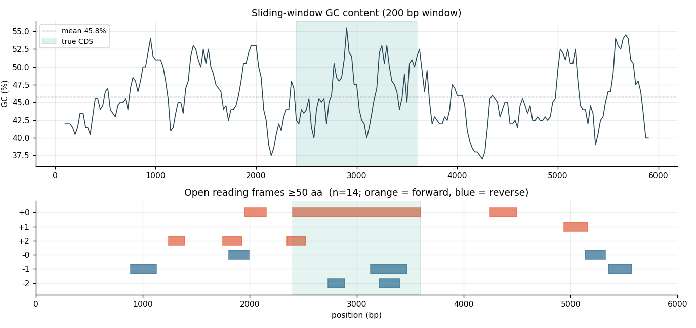
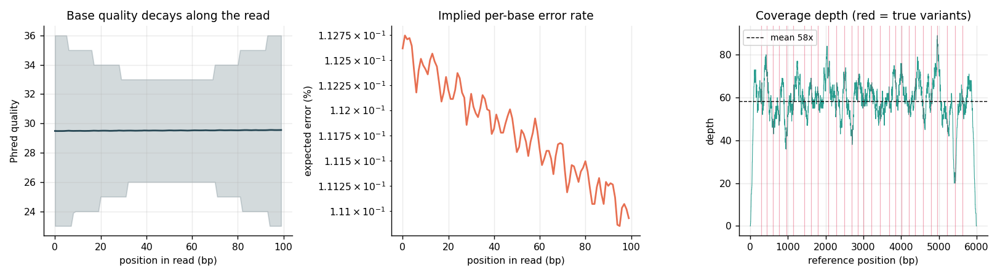
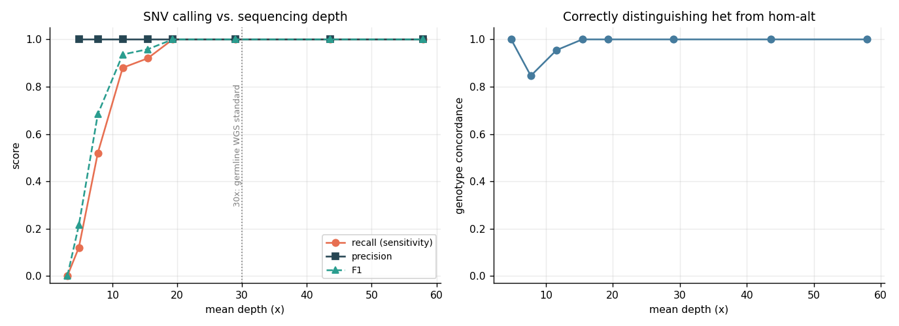
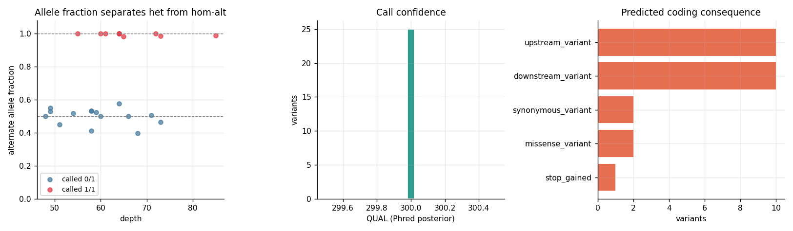
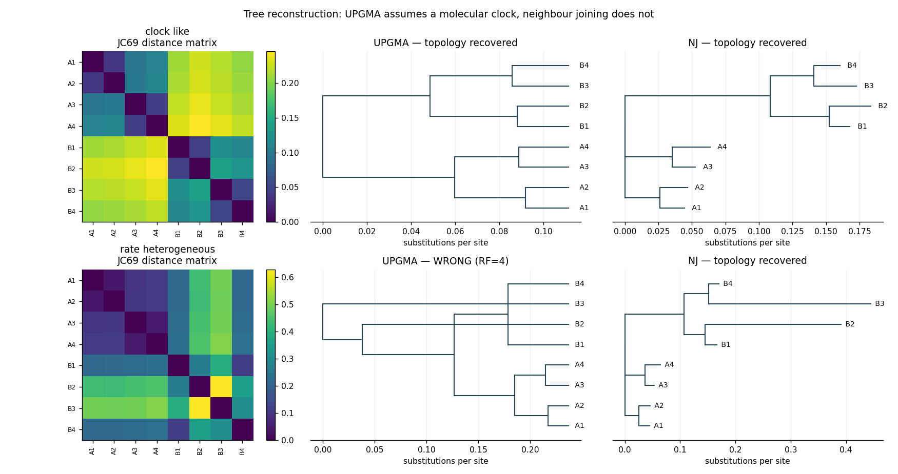

# Genomics Variant Calling & Phylogenetics Toolkit

A from-scratch bioinformatics pipeline: **sequence analysis → read mapping → Bayesian variant calling → VCF output with coding-effect annotation → phylogenetic reconstruction**. Every core algorithm is implemented rather than imported — the genetic code, Needleman–Wunsch, Smith–Waterman, seed-and-extend mapping, genotype likelihoods, UPGMA and neighbour joining.

Ground truth is known at every stage, so accuracy is *measured* rather than asserted. Runs end to end in under 10 seconds with no dataset download.

---

## Results

**Variant calling** (6 kb locus, 25 SNVs, diploid donor, 58× mean depth, 3,600 reads):

| Metric | Value |
|---|---|
| Read mapping rate | 97.2 % |
| SNV precision / recall / F1 | **1.000 / 1.000 / 1.000** |
| Genotype concordance (het vs. hom-alt) | **1.000** |
| **Minimum depth for ≥95 % recall** | **19.3×** |

**Coverage titration** — the headline result, and the reason 30× is the germline WGS standard:

| Mean depth | Precision | Recall | F1 |
|---|---|---|---|
| 3.1× | — (no calls) | 0.000 | 0.000 |
| 4.8× | 1.000 | 0.120 | 0.214 |
| 7.8× | 1.000 | 0.520 | 0.684 |
| 11.6× | 1.000 | 0.880 | 0.936 |
| 15.4× | 1.000 | 0.920 | 0.958 |
| 19.3× | 1.000 | **1.000** | **1.000** |
| 29.0×–57.9× | 1.000 | 1.000 | 1.000 |

Recall climbs steeply and saturates near 20×; precision never degrades, because the caller stays silent rather than guessing when evidence is thin.

**Consequence annotation** of the 25 called variants: 10 upstream, 10 downstream, 2 synonymous, 2 missense, 1 stop-gained — each with HGVS `c.` and `p.` notation in the VCF.

**Indel discovery**: 3/3 recovered by Needleman–Wunsch local reassembly. The read mapper finds **0** — it is ungapped by construction, which is exactly the point.

**Phylogenetics** (8 taxa, 4 kb, reconstruction scored against the known tree by Robinson–Foulds):

| Scenario | Methods recovering the true topology |
|---|---|
| Clock-like evolution | **6/6** — every distance × builder combination |
| Rate-heterogeneous | **2/6** — only neighbour joining with alignment-based distances |

### Figures

| | |
|---|---|
|  | **Fig 1** — sliding-window GC and the six-frame ORF map; the longest ORF recovers the true CDS exactly |
|  | **Fig 2** — quality decay along reads, implied error rate, coverage depth with true variants marked |
|  | **Fig 3** — sensitivity vs. sequencing depth, and genotype concordance |
|  | **Fig 4** — allele fraction separating het from hom-alt, QUAL distribution, consequence breakdown |
|  | **Fig 5** — distance matrices and reconstructed trees under both evolutionary scenarios |

---

## Three results worth explaining

**1. Bayesian genotype likelihoods beat an allele-fraction threshold.** For each site the likelihood of the observed bases is computed under three genotypes — hom-ref, het, hom-alt — weighting every read by its own error probability from its base quality. QUAL is the Phred-scaled posterior that the site is *not* hom-ref. A fixed "call it if 20 % of reads carry the alt" rule treats 1-of-5 reads identically to 20-of-100, and ignores whether those alt bases were Q35 or Q13. The likelihood model handles both automatically, and it is why precision stays at 1.000 all the way down to 5× while recall collapses.

**2. UPGMA fails under rate heterogeneity; neighbour joining does not.** UPGMA assumes a molecular clock. When one lineage evolves ~5× faster, it looks distant from everything and gets dragged toward the base of the tree — classic long-branch attraction. NJ subtracts each taxon's average divergence before pairing, and recovers the correct topology. Both are implemented here and the failure is reproduced as a passing unit test rather than merely described. Note also that **alignment-free k-mer distance fails in this scenario even with NJ**: speed costs the ability to correct for rate variation.

**3. An ungapped mapper cannot see indels — so don't pretend otherwise.** The seed-and-extend mapper uses Hamming distance, which is honest about what it is. Indels are recovered on a second track, by Needleman–Wunsch on windows around candidate sites. Full 6 kb × 6 kb dynamic programming would be 36 million cells in pure Python; local windows make it tractable, which is also why real callers such as GATK HaplotypeCaller do local reassembly rather than global alignment.

---

## Quick start

```bash
git clone <your-repo-url>
cd 03-genomics-variant-toolkit
pip install -r requirements.txt

python -m src.pipeline                       # ~8 s, writes results/
python -m src.pipeline --coverage 15 --n-snv 40 --length 10000
pytest -q                                    # 34 unit tests
```

Outputs include a spec-compliant `results/variants.vcf` (VCF 4.2, with `FILTER`, `INFO/CSQ`, `FORMAT` GT:DP:AD), plus FASTA, FASTQ, and CSV tables.

## Repository layout

```
src/sequence.py   genetic code, translation, ORFs, GC, Phred, FASTA/FASTQ IO,
                  protein MW / pI / Kyte-Doolittle hydropathy
src/align.py      Needleman-Wunsch, Smith-Waterman, k-mer index, read mapper
src/simulate.py   reference + diploid donor + read simulation with error models
src/variants.py   pileup, genotype likelihoods, filters, VCF, HGVS annotation
src/phylo.py      sequence evolution, JC69 / k-mer distances, UPGMA, NJ, RF
src/pipeline.py   orchestration, coverage titration, figures, metrics export
tests/            34 unit tests
results/          VCF, FASTA, FASTQ, CSVs, figures, metrics.json
```

## Validated behaviour (test suite)

The tests check *correctness against known biology*, not merely that functions return: the genetic code must contain all 64 codons with exactly six each for leucine and serine; reverse complement must be its own inverse; a planted gene must be recovered by the ORF finder with reverse-strand hits reported in forward coordinates; Phred 20 must mean exactly 1 % error; free glycine must weigh ~75 Da; a poly-Asp peptide must have a lower pI than a poly-Lys one; heterozygous variants must appear on one haplotype and homozygous ones on both; genotype likelihoods must prefer het at balanced allele fraction and hom-alt when all reads carry the alternate; `AAA→AAG` must be synonymous while `TGG→TGA` must be stop-gained; a 1 bp insertion must be a frameshift and a 3 bp one in-frame; VCF POS must be 1-based; and neighbour joining must strictly beat UPGMA under rate heterogeneity.

## Limitations and honest caveats

- **Data are simulated.** The reference is random sequence with a planted CDS, so it lacks repeats, segmental duplications, homopolymers, GC-extreme regions and pseudogenes — precisely the places where real callers struggle. Perfect precision at 58× would not survive contact with a real genome.
- **The mapper is ungapped and single-end.** No paired-end information, no split-read or soft-clipping support, no proper MAPQ from best-vs-second-best hit comparison. Repetitive regions would be mapped over-confidently.
- **No local realignment or base-quality score recalibration**, both of which materially change real-world results.
- Indel *calling from reads* is not implemented — only indel *discovery from assembled sequence*.
- Phylogenetic distances are computed on ungapped, equal-length sequences; real analyses need multiple sequence alignment first, and maximum-likelihood or Bayesian tree inference rather than distance methods.
- The natural extension is to swap `simulate.py` for `pysam` + a real BAM/reference; everything downstream consumes `(reference_string, mappings)`.

## References

1. Needleman S.B., Wunsch C.D. *A general method applicable to the search for similarities in the amino acid sequence of two proteins.* J. Mol. Biol. 48(3):443–453, 1970.
2. Smith T.F., Waterman M.S. *Identification of common molecular subsequences.* J. Mol. Biol. 147(1):195–197, 1981.
3. Li H., Durbin R. *Fast and accurate short read alignment with Burrows-Wheeler transform.* Bioinformatics 25(14):1754–1760, 2009.
4. Li H. *A statistical framework for SNP calling…* Bioinformatics 27(21):2987–2993, 2011.
5. Jukes T.H., Cantor C.R. *Evolution of protein molecules.* In: Mammalian Protein Metabolism, 1969.
6. Saitou N., Nei M. *The neighbor-joining method.* Mol. Biol. Evol. 4(4):406–425, 1987.
7. Robinson D.F., Foulds L.R. *Comparison of phylogenetic trees.* Math. Biosci. 53(1–2):131–147, 1981.
8. Kyte J., Doolittle R.F. *A simple method for displaying the hydropathic character of a protein.* J. Mol. Biol. 157(1):105–132, 1982.
9. Danecek P. et al. *The variant call format and VCFtools.* Bioinformatics 27(15):2156–2158, 2011.

## License

MIT
